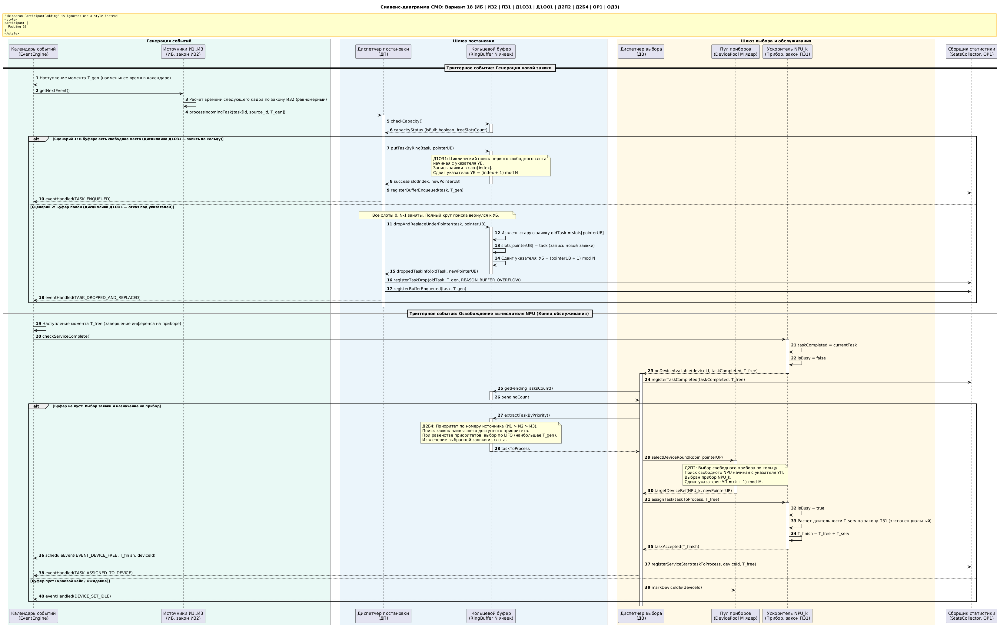
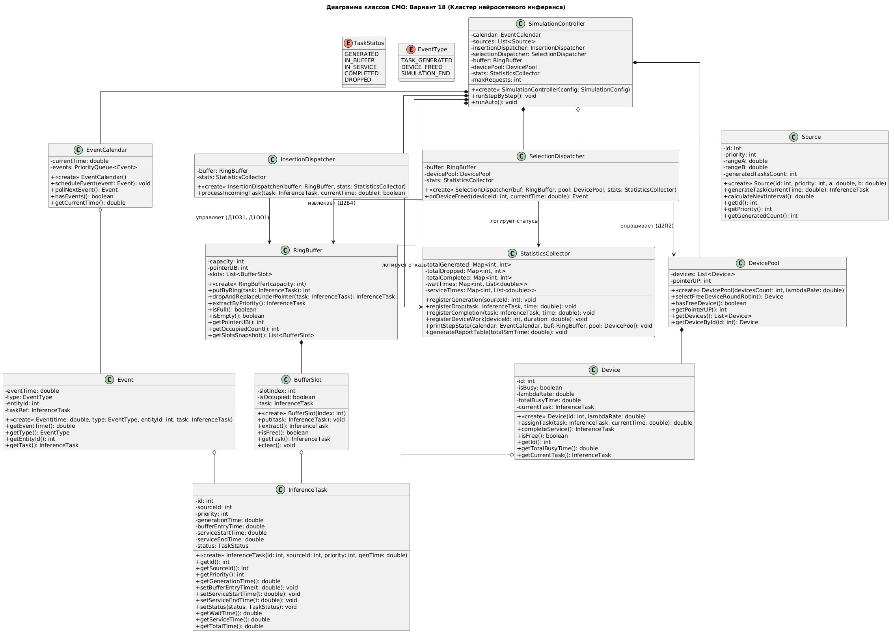

# Моделирование вычислительной системы массового обслуживания (СМО)
## Вариант 18: Кластер распределенного нейросетевого инференса (Edge AI Gateway)

[]()
[]()
[]()

---

### Сведения об авторе и работе
* **Учебное заведение:** Санкт-Петербургский политехнический университет Петра Великого (СПбПУ)
* **Институт:** Институт компьютерных наук и технологий (ИКНТ)
* **Подразделение:** Высшая школа программной инженерии (ВШПИ)
* **Дисциплина:** Архитектура Программных Систем
* **Студент:** Федоров Олег Александрович
* **Учебная группа:** 5130904/40106
* **Номер варианта:** 18

---

## 1. Формула задания и расшифровка

**Спецификация варианта:**  
$$\text{ИБ} \mid \text{ИЗ2} \mid \text{ПЗ1} \mid \text{Д1ОЗ1} \mid \text{Д1ОО1} \mid \text{Д2П2} \mid \text{Д2Б4} \mid \text{ОР1} \mid \text{ОД3}$$

| Код компонента | Наименование параметра | Расшифровка логики функционирования |
| :--- | :--- | :--- |
| **ИБ** | Тип источников | **Бесконечный источник.** Источники генерируют задачи непрерывно на протяжении всего времени работы системы. |
| **ИЗ2** | Закон генерации заявок | **Равномерный закон распределения** интервалов между генерацией заявок на отрезке $[a, b]$. |
| **ПЗ1** | Закон времени обслуживания | **Экспоненциальный закон распределения** времени обработки заявки на вычислительном приборе с параметром $\mu$. |
| **Д1ОЗ1** | Дисциплина буферизации | **Заполнение буферной памяти «по кольцу».** Поиск свободного слота начинается с текущего указателя буфера ($УБ$). При нахождении свободного места заявка записывается в него, а $УБ$ смещается на следующую позицию: $УБ = (index + 1) \pmod N$. |
| **Д1ОО1** | Дисциплина отказа | **Отказ под указателем.** Если при поступлении заявки все места в буфере заняты, указатель $УБ$, обойдя весь буфер, возвращается на исходную ячейку. Заявка, находящаяся в этой ячейке, принудительно вытесняется (drop) и покидает систему, а новая заявка занимает ее слот. $УБ$ сдвигается на $+1$. |
| **Д2П2** | Дисциплина выбора прибора | **Выбор свободного прибора «по кольцу».** Поиск свободного вычислителя начинается с текущего положения указателя приборов ($УП$). Заявка передается первому свободному прибору, а указатель смещается: $УП = (k + 1) \pmod M$. |
| **Д2Б4** | Дисциплина выбора заявки | **Приоритет по номеру источника, по одной заявке.** При освобождении прибора на обслуживание выбирается одна заявка от источника с наивысшим приоритетом ($И_1 > И_2 > И_3$). При наличии нескольких заявок одного приоритета выбор производится по правилу **LIFO** (наиболее свежая по времени генерации заявка). |
| **ОР1** | Отражение результатов (авто) | **Сводная таблица результатов.** Вывод суммарной статистики по источникам и приборам после завершения прогона модели. |
| **ОД3** | Отражение динамики (пошагово) | **Временные диаграммы (Waveform).** Визуализация динамики изменения состояний источников, приборов, ячеек буфера и отказов во времени. |

---

## 2. Концептуальная модель бизнес-домена

В качестве моделируемой системы рассматривается **аппаратно-программный шлюз локального инференса нейросетевых моделей (Edge AI Inference Gateway)**, развернутый на объекте для обработки мультимедийных данных реального времени.

* **Источники заявок:**
  1. $И_1$ (Приоритет 1 — Наивысший): Подсистема биометрической безопасности и распознавания лиц на КПП. Критична к задержкам.
  2. $И_2$ (Приоритет 2 — Средний): Подсистема компьютерного зрения для оптического контроля брака продукции на конвейере.
  3. $И_3$ (Приоритет 3 — Базовый): Подсистема мониторинга свободных парковочных мест и интенсивности трафика.
* **Заявка ($Task$):** Запрос на выполнение прямого прохода нейронной сети (Inference Task) над входным тензором кадра. Содержит идентификатор, метку времени захвата кадра $T_{вх}$ и статус.
* **Буферная память:** Ограниченная кольцевая память дескрипторов задач в быстродействующем ОЗУ шлюза емкостью $N$ ячеек.
* **Обслуживающие приборы:** Параллельные аппаратные ускорители нейросетевого инференса (NPU / GPU Tensor Cores) в количестве $M$ модулей.

---

## 3. Таблица маппинга (СМО $\leftrightarrow$ Бизнес-домен)

| Элемент СМО | Сущность бизнес-домена | Назначение в архитектуре |
| :--- | :--- | :--- |
| **Источник** | Видеокамеры подсистем ($И_1, И_2, И_3$) | Генерация кадров для обработки с квазиравномерным шагом стробирования. |
| **Заявка** | Задача на инференс кадра (`InferenceTask`) | Пакет тензорных данных и метаданных для обработки моделью. |
| **Буферная память** | Кольцевой буфер дескрипторов задач в ОЗУ | Временное хранение кадров до освобождения вычислителей ($N$ слотов). |
| **Прибор** | Аппаратный ускоритель (NPU / GPU Core) | Выполнение вычислений модели машинного обучения над одним кадром. |
| **Диспетчер постановки** | Контроллер очередей входного потока (DMA) | Поиск слота по кольцу (**Д1ОЗ1**) и организация вытеснения под указателем (**Д1ОО1**). |
| **Диспетчер выбора** | Диспетчер планирования вычислений | Выбор наиболее приоритетной заявки (**Д2Б4**) и циклическое назначение ядра (**Д2П2**). |
| **Отказ** | Сброс кадра (Frame Drop) | Вытеснение устаревшего кадра из слота под указателем при нехватке памяти. |
| **Обслуживание** | Процесс инференса нейросети | Выполнение прямого прохода модели ускорителем за экспоненциальное время. |
| **Выход из системы** | Завершенный кадр или сброс | Фиксация метрик в модуле сбора статистики. |

---

## 4. Первичные проектные артефакты

### 4.1. Sequence Diagram (Диаграмма последовательности)
Описывает сквозной цикл работы системы по особым состояниям (подход особых событий), охватывая сценарии штатной постановки, отказа при переполнении буфера, выборки по приоритету и назначения на свободный прибор.



> **Исходный код:** [`diagrams/sequence_diagram.puml`](diagrams/sequence_diagram.puml)

---

### 4.2. Class Diagram (Диаграмма классов)
Отражает модульную объектно-ориентированную структуру программного комплекса. Все атрибуты инкапсулированы (private), взаимодействие между сущностями организовано через ссылки (ассоциация/агрегация), методы содержат строгую типизацию.



> **Исходный код:** [`diagrams/class_diagram.puml`](diagrams/class_diagram.puml)

---

### 4.3. Swimlane Flowchart (Блок-схема с дорожками)
Демонстрирует ветвления алгоритма, проверку условий и распределение ответственности между активными компонентами: календарем событий, диспетчерами, буфером и пулом приборов.


> **Исходный код:** [`diagrams/swimlane_flowchart.puml`](diagrams/swimlane_flowchart.puml)

---

## 5. Структура репозитория

```text
.
├── README.md                      # Главная документация проекта и описание первичных артефактов
├── docs/                          # Формализованные документы описания предметной области
│   ├── mapping.docx               # Спецификация маппинга терминов СМО на сущности бизнес-домена
│   └── business_domain.docx       # Полное текстовое описание моделируемой вычислительной системы
└── diagrams/                      # Исходные PlantUML-скрипты и срендеренные изображения диаграмм
    ├── sequence_diagram.puml      # Исходный код Sequence Diagram
    ├── sequence_diagram.png       # Графическое представление Sequence Diagram
    ├── class_diagram.puml         # Исходный код Class Diagram
    ├── class_diagram.png          # Графическое представление Class Diagram
    ├── swimlane_flowchart.puml    # Исходный код Flowchart с дорожками
    └── swimlane_flowchart.png     # Графическое представление Flowchart
```